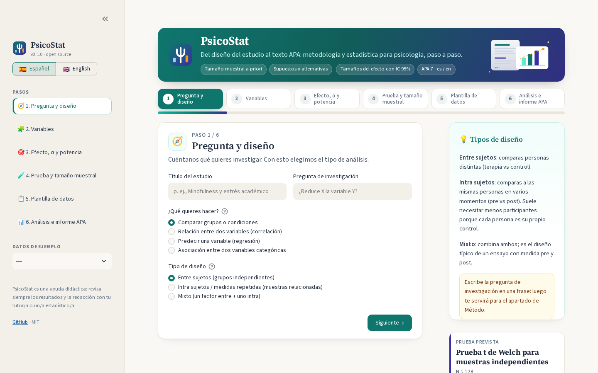
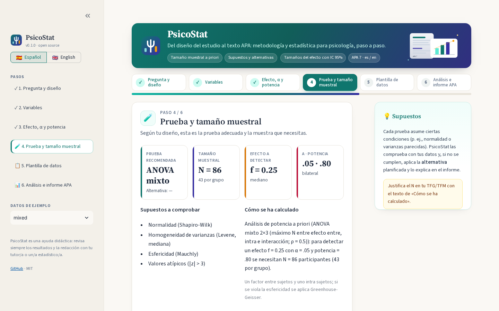
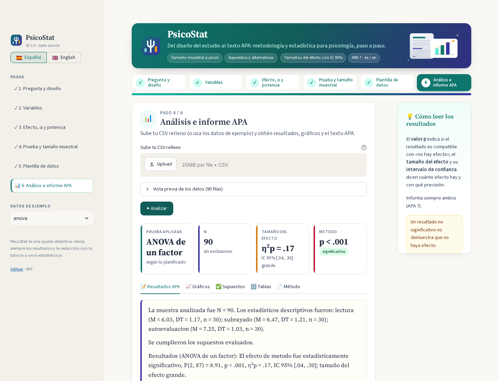

<p align="center"></p>

# PsicoStat 📊

**Demo:** [psicostat.streamlit.app](https://psicostat.streamlit.app/)

**Asistente open source de metodología y análisis estadístico para psicología** · *Open-source methods & statistics assistant for psychology* — [English below](#english)

[](https://github.com/hecogo1/psicostat/actions/workflows/ci.yml)


PsicoStat te guía paso a paso desde la pregunta de investigación hasta el texto de **Método** y **Resultados** en estilo **APA 7**, en español o inglés:

1. **Asistente**: te pregunta el diseño (entre sujetos, intra sujetos, mixto, correlacional, regresión, asociación, mediación, moderación, fiabilidad de una escala, acuerdo entre evaluadores, datos anidados o multinivel), número de grupos o condiciones, nivel de medida de las variables, covariables, tamaño del efecto esperado (con la guía de Cohen), α y potencia.
2. **Prueba recomendada**: t de Welch, t pareada, Mann-Whitney, Wilcoxon, ANOVA de un factor / Welch / factorial / medidas repetidas / mixto, ANCOVA, Kruskal-Wallis, Friedman, chi-cuadrado / Fisher, McNemar, Q de Cochran, Pearson / Spearman (también **correlación parcial** controlando covariables), regresión lineal, logística y logística ordinal (odds proporcionales), mediación simple (efecto indirecto con IC bootstrap), moderación (interacción X × W con ΔR², pendientes simples y gráfico), fiabilidad de escalas (α de Cronbach con IC de Feldt, ω de McDonald, correlación ítem-resto y α si se elimina el ítem, con recodificación de ítems inversos), acuerdo entre evaluadores (κ de Cohen, ponderada si las categorías son ordinales, κ de Fleiss con 3+ evaluadores y CCI de dos factores), modelo lineal mixto multinivel (intercepto y pendiente aleatorios, CCI del modelo nulo, efectos fijos con IC 95%, componentes de varianza y R² marginal y condicional); con supuestos a comprobar y alternativa no paramétrica. Las pruebas t pueden complementarse con una **prueba de equivalencia (TOST)** para poder concluir que no hay un efecto relevante.
3. **Tamaño muestral a priori**, explicado y validado frente a G*Power.
4. **Plantilla CSV** con las columnas exactas de tu diseño + **diccionario de datos**.
5. **Análisis** del CSV relleno: descriptivos, supuestos (Shapiro-Wilk, Levene, Mauchly, Breusch-Pagan, VIF, Brant…), la prueba (con cambio automático a la alternativa si fallan los supuestos), **tamaños del efecto con IC 95%**, post hoc (Tukey, Games-Howell, Dunn, Holm) y gráficos.
6. **Informe APA 7** en Markdown y Word (DOCX), en español e inglés.

> ⚠️ PsicoStat es una ayuda didáctica. Revisa siempre los resultados y la redacción con tu tutor/a o un/a estadístico/a.

## Sobre el proyecto

PsicoStat es un proyecto independiente creado por Héctor Cózar, antiguo estudiante de la Facultad de Psicología de la Universidad Complutense de Madrid. No es un proyecto oficial de la universidad.

Nació como un trabajo previo al doctorado, pero su objetivo va más allá: ayudar a la investigación ofreciendo una herramienta accesible a personas con menos formación técnica, para que puedan diseñar la metodología y el análisis estadístico de sus estudios con rigor. Empieza por la psicología, pero está pensada para todas las ciencias sociales y de la salud.



<details><summary>Más capturas / More screenshots</summary>




</details>

## Instalación

```bash
git clone https://github.com/hecogo1/psicostat.git
cd psicostat
python -m venv .venv && source .venv/bin/activate      # Windows: .venv\Scripts\activate
pip install -e ".[app]"
```

## Uso rápido

### Interfaz web (recomendada)

```bash
psicostat app
```

Se abre en el navegador (http://localhost:8501). La barra lateral muestra los seis pasos del asistente (puedes saltar entre ellos), el idioma y los estudios de ejemplo; cada pantalla incluye a la derecha una explicación sencilla del concepto estadístico. Descarga la plantilla en el paso 5 y sube tu CSV en el paso 6. Puedes probar con los **datos de ejemplo** de la barra lateral.

### Línea de comandos

```bash
# 1) Asistente interactivo: crea estudio/diseno.json y estudio/plantilla.csv (+ diccionario)
psicostat wizard --out estudio

# 2) Ver prueba recomendada y tamaño muestral de un diseño
psicostat plan estudio/diseno.json

# 3) Regenerar la plantilla con otro N
psicostat template estudio/diseno.json --n 60 --out estudio/plantilla.csv

# 4) Analizar los datos y generar informes (es + en, Markdown + DOCX)
psicostat analyze estudio/diseno.json estudio/plantilla.csv --out estudio/resultados

# Ejemplos simulados: ttest, mannwhitney, paired, anova, factorial, ancova, rm, mixed,
# chi2, correlation, regression, logistic, ordinal, mediation, moderation, reliability, kappa, icc, multilevel, mcnemar, equivalence, partial
psicostat example anova --out ejemplo
psicostat analyze ejemplo/diseno.json ejemplo/datos.csv --out ejemplo/resultados
```

Usa `psicostat --lang en ...` para mensajes en inglés.

**Contrastes unilaterales**: para pruebas t, Mann-Whitney, Wilcoxon y correlaciones puedes plantear una hipótesis direccional (`"alternative": "greater"` = nivel 1 > nivel 2 o relación positiva; `"less"` = lo contrario) en el asistente, en la web (paso 3) o con `--alternative greater|less` en `plan` y `analyze`. El tamaño muestral se calcula con α unilateral y el informe lo indica («p = ,012 (unilateral)», H₁ en el Método). Úsalos solo si la dirección se predijo antes de ver los datos.

**Prueba de equivalencia (TOST)**: un resultado no significativo no demuestra que no haya efecto. Para la t de Welch y la t pareada puedes fijar el menor tamaño del efecto que te importaría, Δ (`"equivalence_bound": 0.4` en `diseno.json`, en d de Cohen o, con `"equivalence_units": "raw"`, en puntos de la VD), en el asistente, en la web (paso 3, «Prueba de equivalencia») o con `--equivalence 0.4 [--equivalence-units raw]` en `plan` y `analyze`. PsicoStat aplica dos contrastes unilaterales frente a −Δ y +Δ (Schuirmann, 1987; Lakens, 2017), informa el IC al 90% de la diferencia y redacta la conclusión combinada con la prueba de diferencia (Lakens et al., 2018): diferencia relevante, diferencia real pero irrelevante, equivalencia o resultado no concluyente. El plan indica también el N necesario para demostrar equivalencia. Justifica Δ antes de recoger los datos. Ejemplo: `psicostat example equivalence`.

**Coma decimal**: añade `--decimal-comma` a `psicostat analyze` (o activa «Coma decimal en el informe» en la barra lateral de la web, o `"decimal_comma": true` en `diseno.json`) para que el informe en español use coma decimal (`M = 3,25; p = ,032; IC 95% [0,08; 1,36]`). El informe en inglés siempre usa punto.

### Desde Python

```python
from psicostat import Design, recommend, sample_size, make_template, analyze, build_report, to_docx

d = Design(analysis="compare", design="between", n_groups=3,
           levels=["lectura", "subrayado", "autoevaluacion"], iv_name="metodo", dv_name="rendimiento")
print(recommend(d).label("es"), sample_size(d)["n_total"])   # ANOVA de un factor 159
res = analyze(d, "datos.csv", outdir="figuras")
to_docx(build_report(res, "es"), "informe.docx")
```

## Ejemplo de salida

> Resultados (ANOVA de un factor): El efecto de metodo fue estadísticamente significativo, F(2, 87) = 8.91, p < .001, η²p = .17, IC 95% [.04, .30]; tamaño del efecto grande. Las comparaciones post hoc (Tukey HSD) mostraron diferencias significativas en: lectura vs autoevaluacion (p < .001); subrayado vs autoevaluacion (p = .025).

Ver [`examples/`](examples/) para informes completos generados con los datos de ejemplo.

## Formato del CSV

- Una fila por participante; columna `id` obligatoria.
- **Entre sujetos**: una columna para el grupo y otra para la VD.
- **Intra sujetos / mixto**: formato ancho, una columna por condición: `<vd>_<condición>` (p. ej., `estres_pre`, `estres_post`).
- Usa punto decimal (`3.5`). Las filas incompletas se excluyen (y se informa).
- **Multinivel**: formato largo, una fila por observación (nivel 1), con una columna que identifica el grupo de nivel 2 (`clase`, `centro`, `terapeuta`… o el participante, si cada persona aporta varias medidas). Los predictores pueden ser de nivel 1 o de nivel 2 (PsicoStat detecta cuál); los dicotómicos se codifican 0/1.
- Consulta el diccionario de datos que se genera junto a la plantilla.

## Decisiones metodológicas

| Situación | Decisión |
|---|---|
| 2 grupos independientes | t de Welch por defecto (Delacre et al., 2017) |
| Normalidad violada y n < 30 por grupo | Alternativa no paramétrica automática |
| ANOVA con varianzas heterogéneas | ANOVA de Welch + Games-Howell |
| Esfericidad violada (Mauchly p < .05) | Corrección de Greenhouse-Geisser; con dos factores intra sujetos, por efecto (A, B y A × B), informando ε_GG y ε_HF; en el ANOVA mixto, con la matriz de covarianzas intragrupo combinada (N − G gl) |
| 2×2 con esperadas < 5 | Prueba exacta de Fisher |
| Heterocedasticidad en regresión | Errores típicos HC3 |
| Pruebas de rangos | N a priori ÷ 0.864 (eficiencia relativa asintótica) |
| Regresión logística | 10 eventos por predictor (mín. 100) |
| Fiabilidad de una escala | α de Cronbach con IC exacto de Feldt et al. (1987) y prueba F frente al α mínimo (.70 por defecto) + ω total de McDonald (modelo de un factor por máxima verosimilitud, IC bootstrap), porque α supone tau-equivalencia (McNeish, 2018); los ítems inversos se recodifican (mín. + máx. − x); N a priori por Bonett (2002) |
| Acuerdo entre evaluadores | Categorías y 2 evaluadores: κ de Cohen (ponderada cuadrática si son ordinales) con IC asintótico de Fleiss, Cohen y Everitt (1969); 3+ evaluadores: κ de Fleiss con IC bootstrap; puntuaciones cuantitativas: CCI(A,1) de dos factores y acuerdo absoluto (Koo y Li, 2016) con IC y pruebas F de McGraw y Wong (1996), más CCI(C,1), CCI(A,k) y CCI(C,k). Se contrasta frente a un acuerdo mínimo aceptable (.40 por defecto; 0 = frente al azar). N a priori: potencia exacta de la F para el CCI y fórmula de Cantor (1996) para κ |
| Datos anidados (alumnado en clases, pacientes por terapeuta, medidas repetidas en formato largo) | Modelo lineal mixto por REML (statsmodels `MixedLM`) con intercepto aleatorio y, opcionalmente, pendiente aleatoria de un predictor de nivel 1; predictores centrados en la media general. CCI y efecto de diseño del modelo nulo con prueba de razón de verosimilitudes de la varianza (mezcla de χ²; Self y Liang, 1987); efectos fijos con pruebas z de Wald e IC 95%; R² marginal y condicional (Nakagawa y Schielzeth, 2013; Johnson, 2014); aviso si hay menos de 30 grupos (Maas y Hox, 2005) o si un predictor de nivel 1 mezcla efectos intra y entre grupos (Enders y Tofighi, 2007). N a priori: N efectivo de la prueba de un efecto fijo (f²) × efecto de diseño 1 + (m − 1)·CCI (Kish, 1965). Validado frente a lme4 |
| Concluir ausencia de un efecto relevante (dos grupos o dos medidas) | Prueba de equivalencia TOST con los mismos EE y gl que la prueba t (Welch o pareada): equivalencia si ambos contrastes unilaterales son significativos, es decir, si el IC (1 − 2α) de la diferencia cae dentro de ±Δ (Schuirmann, 1987; Lakens, 2017). Δ en d se pasa a la escala de la VD con la DT media √((s₁² + s₂²)/2) o la DT de las diferencias. N a priori con la aproximación t de Chow et al. (2008), comprobada por simulación. Validado frente a statsmodels `ttost_ind` / `ttost_paired` |
| Relación entre dos variables controlando terceras variables | Correlación parcial: r entre los residuos de X e Y tras regresarlos sobre las k covariables (equivale a la t de X en la regresión de Y sobre X + covariables), con N − 2 − k gl e IC por la z de Fisher con EE 1/√(N − 3 − k); con variables ordinales o sin normalidad, la misma fórmula sobre los rangos (Spearman parcial, EE de Bonett y Wright, 2000). N a priori: N de la correlación de orden cero + k (Cohen, 1988). Validado frente a statsmodels OLS |
| Regresión con VD ordinal (p. ej., un ítem Likert) | Regresión logística ordinal de odds proporcionales + prueba de Brant (1990); N a priori por Whitehead (1993). La suma de varios ítems se trata como cuantitativa |

Puedes desactivar el cambio automático con `"auto_fallback": false` en `diseno.json`.

## Contribuir

¡Las contribuciones son bienvenidas! Lee [CONTRIBUTING.md](CONTRIBUTING.md) y el [Código de conducta](CODE_OF_CONDUCT.md).

## Referencias

- Aguinis, H., Beaty, J. C., Boik, R. J., & Pierce, C. A. (2005). Effect size and power in assessing moderating effects of categorical variables using multiple regression: A 30-year review. *Journal of Applied Psychology, 90*(1), 94–107.
- Aiken, L. S., & West, S. G. (1991). *Multiple regression: Testing and interpreting interactions*. Sage.
- American Psychological Association. (2020). *Publication manual of the American Psychological Association* (7th ed.).
- Bates, D., Mächler, M., Bolker, B., & Walker, S. (2015). Fitting linear mixed-effects models using lme4. *Journal of Statistical Software, 67*(1), 1–48.
- Bonett, D. G. (2002). Sample size requirements for testing and estimating coefficient alpha. *Journal of Educational and Behavioral Statistics, 27*(4), 335–340.
- Bonett, D. G., & Wright, T. A. (2000). Sample size requirements for estimating Pearson, Kendall and Spearman correlations. *Psychometrika, 65*(1), 23–28.
- Brant, R. (1990). Assessing proportionality in the proportional odds model for ordinal logistic regression. *Biometrics, 46*(4), 1171–1178.
- Cantor, A. B. (1996). Sample-size calculations for Cohen's kappa. *Psychological Methods, 1*(2), 150–153.
- Chow, S.-C., Shao, J., & Wang, H. (2008). *Sample size calculations in clinical research* (2nd ed.). Chapman & Hall/CRC.
- Clopper, C. J., & Pearson, E. S. (1934). The use of confidence or fiducial limits illustrated in the case of the binomial. *Biometrika, 26*(4), 404–413.
- Cohen, J. (1960). A coefficient of agreement for nominal scales. *Educational and Psychological Measurement, 20*(1), 37–46.
- Cohen, J. (1988). *Statistical power analysis for the behavioral sciences* (2nd ed.). Erlbaum.
- Cronbach, L. J. (1951). Coefficient alpha and the internal structure of tests. *Psychometrika, 16*(3), 297–334.
- DeLong, E. R., DeLong, D. M., & Clarke-Pearson, D. L. (1988). Comparing the areas under two or more correlated receiver operating characteristic curves: A nonparametric approach. *Biometrics, 44*(3), 837–845.
- Delacre, M., Lakens, D., & Leys, C. (2017). Why psychologists should by default use Welch's t-test. *International Review of Social Psychology, 30*(1), 92–101.
- Faul, F., Erdfelder, E., Lang, A.-G., & Buchner, A. (2007). G*Power 3. *Behavior Research Methods, 39*, 175–191.
- Enders, C. K., & Tofighi, D. (2007). Centering predictor variables in cross-sectional multilevel models: A new look at an old issue. *Psychological Methods, 12*(2), 121–138.
- Feinstein, A. R., & Cicchetti, D. V. (1990). High agreement but low kappa: I. The problems of two paradoxes. *Journal of Clinical Epidemiology, 43*(6), 543–549.
- Feldt, L. S., Woodruff, D. J., & Salih, F. A. (1987). Statistical inference for coefficient alpha. *Applied Psychological Measurement, 11*(1), 93–103.
- Fleiss, J. L. (1971). Measuring nominal scale agreement among many raters. *Psychological Bulletin, 76*(5), 378–382.
- Fleiss, J. L., & Cohen, J. (1973). The equivalence of weighted kappa and the intraclass correlation coefficient as measures of reliability. *Educational and Psychological Measurement, 33*(3), 613–619.
- Fleiss, J. L., Cohen, J., & Everitt, B. S. (1969). Large sample standard errors of kappa and weighted kappa. *Psychological Bulletin, 72*(5), 323–327.
- Fleiss, J. L., Nee, J. C. M., & Landis, J. R. (1979). Large sample variance of kappa in the case of different sets of raters. *Psychological Bulletin, 86*(5), 974–977.
- Fritz, M. S., & MacKinnon, D. P. (2007). Required sample size to detect the mediated effect. *Psychological Science, 18*(3), 233–239.
- George, D., & Mallery, P. (2003). *SPSS for Windows step by step: A simple guide and reference* (4th ed.). Allyn & Bacon.
- Hayes, A. F. (2022). *Introduction to mediation, moderation, and conditional process analysis* (3rd ed.). Guilford Press.
- Hosmer, D. W., Lemeshow, S., & Sturdivant, R. X. (2013). *Applied logistic regression* (3rd ed.). Wiley.
- Hsieh, F. Y., Bloch, D. A., & Larsen, M. D. (1998). A simple method of sample size calculation for linear and logistic regression. *Statistics in Medicine, 17*(14), 1623–1634.
- Johnson, P. C. D. (2014). Extension of Nakagawa & Schielzeth's R²GLMM to random slopes models. *Methods in Ecology and Evolution, 5*(9), 944–946.
- Kish, L. (1965). *Survey sampling*. Wiley.
- Koo, T. K., & Li, M. Y. (2016). A guideline of selecting and reporting intraclass correlation coefficients for reliability research. *Journal of Chiropractic Medicine, 15*(2), 155–163.
- Lakens, D. (2017). Equivalence tests: A practical primer for t tests, correlations, and meta-analyses. *Social Psychological and Personality Science, 8*(4), 355–362.
- Lakens, D. (2022). Sample size justification. *Collabra: Psychology, 8*(1), 33267.
- Lakens, D., Scheel, A. M., & Isager, P. M. (2018). Equivalence testing for psychological research: A tutorial. *Advances in Methods and Practices in Psychological Science, 1*(2), 259–269.
- Landis, J. R., & Koch, G. G. (1977). The measurement of observer agreement for categorical data. *Biometrics, 33*(1), 159–174.
- Maas, C. J. M., & Hox, J. J. (2005). Sufficient sample sizes for multilevel modeling. *Methodology, 1*(3), 86–92.
- McCullagh, P. (1980). Regression models for ordinal data. *Journal of the Royal Statistical Society: Series B, 42*(2), 109–142.
- McGraw, K. O., & Wong, S. P. (1996). Forming inferences about some intraclass correlation coefficients. *Psychological Methods, 1*(1), 30–46.
- McDonald, R. P. (1999). *Test theory: A unified treatment*. Erlbaum.
- McNeish, D. (2018). Thanks coefficient alpha, we'll take it from here. *Psychological Methods, 23*(3), 412–433.
- Nakagawa, S., & Schielzeth, H. (2013). A general and simple method for obtaining R² from generalized linear mixed-effects models. *Methods in Ecology and Evolution, 4*(2), 133–142.
- Peduzzi, P., et al. (1996). A simulation study of the number of events per variable in logistic regression analysis. *Journal of Clinical Epidemiology, 49*(12), 1373–1379.
- Schuirmann, D. J. (1987). A comparison of the two one-sided tests procedure and the power approach for assessing the equivalence of average bioavailability. *Journal of Pharmacokinetics and Biopharmaceutics, 15*(6), 657–680.
- Self, S. G., & Liang, K.-Y. (1987). Asymptotic properties of maximum likelihood estimators and likelihood ratio tests under nonstandard conditions. *Journal of the American Statistical Association, 82*(398), 605–610.
- Serlin, R. C., Carr, J., & Marascuilo, L. A. (1982). A measure of association for selected nonparametric procedures. *Psychological Bulletin, 92*(3), 786–790.
- Shrout, P. E., & Fleiss, J. L. (1979). Intraclass correlations: Uses in assessing rater reliability. *Psychological Bulletin, 86*(2), 420–428.
- Sim, J., & Wright, C. C. (2005). The kappa statistic in reliability studies: Use, interpretation, and sample size requirements. *Physical Therapy, 85*(3), 257–268.
- Snijders, T. A. B., & Bosker, R. J. (2012). *Multilevel analysis: An introduction to basic and advanced multilevel modeling* (2nd ed.). Sage.
- Steiger, J. H. (2004). Beyond the F test: Effect size confidence intervals. *Psychological Methods, 9*(2), 164–182.
- Streiner, D. L. (2003). Starting at the beginning: An introduction to coefficient alpha and internal consistency. *Journal of Personality Assessment, 80*(1), 99–103.
- Walter, S. D., Eliasziw, M., & Donner, A. (1998). Sample size and optimal designs for reliability studies. *Statistics in Medicine, 17*(1), 101–110.
- Whitehead, J. (1993). Sample size calculations for ordered categorical data. *Statistics in Medicine, 12*(24), 2257–2271.

---

<a id="english"></a>
## English

**PsicoStat** guides psychology students and researchers step by step from the research question to APA 7 **Method** and **Results** text, in Spanish or English.

**Features**: guided wizard (design, groups/conditions, measurement levels, covariates, mediation, moderation, expected effect size with Cohen's benchmarks, α, power) → recommended test with assumptions and nonparametric fallback (including simple mediation with bootstrap CI for the indirect effect, moderation with the X × W interaction, ΔR², simple slopes and an interaction plot, scale reliability with Cronbach's α (Feldt CI), McDonald's ω and item statistics, partial correlations (Pearson or rank-based Spearman) controlling for covariates, inter-rater agreement with Cohen's κ (weighted for ordinal categories), Fleiss' κ and two-way ICCs, and multilevel linear mixed models for nested data with random intercepts/slopes, null-model ICC, fixed effects with 95% CIs, variance components and marginal/conditional R², validated against lme4; t tests can add a TOST equivalence test to conclude the absence of a meaningful effect) → a priori sample size (validated against G*Power; Fritz & MacKinnon for mediation; Bonett for reliability; exact ICC F-test power and Cantor's formula for κ; design effect for multilevel models) → CSV template + data dictionary → analysis (descriptives, assumption checks, test, effect sizes with 95% CIs, post hoc tests, plots) → APA 7 report in Markdown and DOCX.

### About

PsicoStat is an independent project by Héctor Cózar, a former student of the Faculty of Psychology at the Complutense University of Madrid. It is not an official university project.

It started as pre-doctoral work, but its goal is broader: to support research by giving less technical researchers an accessible tool to plan the methodology and statistical analysis of their studies rigorously. It starts with psychology but is meant for all the social and health sciences.

### Install

```bash
git clone https://github.com/hecogo1/psicostat.git && cd psicostat
python -m venv .venv && source .venv/bin/activate
pip install -e ".[app]"
```

### Use

```bash
psicostat app                                   # local web UI (choose English in the sidebar)
psicostat --lang en wizard --out study          # interactive CLI wizard
psicostat --lang en plan study/diseno.json      # recommended test + sample size
psicostat --lang en analyze study/diseno.json study/plantilla.csv --out study/results
psicostat example mixed --out demo              # simulated example datasets
psicostat --lang en analyze study/diseno.json study/plantilla.csv --equivalence 0.4   # add a TOST equivalence test (bounds ±0.4 d)
```

Reports are always produced in both languages (`informe_es.*`, `informe_en.*`).

### CSV format

One row per participant with an `id` column. Between-subjects: a group column and a DV column. Within/mixed: wide format, one column per condition named `<dv>_<condition>`. Multilevel: long format, one row per observation with a column identifying the level-2 cluster (class, school, therapist… or the participant for repeated measures). Use a dot as decimal separator. Incomplete rows are excluded and reported.

### Contributing

Contributions are welcome — see [CONTRIBUTING.md](CONTRIBUTING.md) and the [Code of Conduct](CODE_OF_CONDUCT.md).

PsicoStat is a teaching aid: always double-check results and wording with your supervisor or a statistician.

License: [MIT](LICENSE).

## Despliegue en Streamlit Community Cloud / Deploy

Repositorio / repository: `hecogo1/psicostat` · rama / branch: `main` · archivo principal / main file path: `streamlit_app.py`. Las dependencias están en `requirements.txt`.
