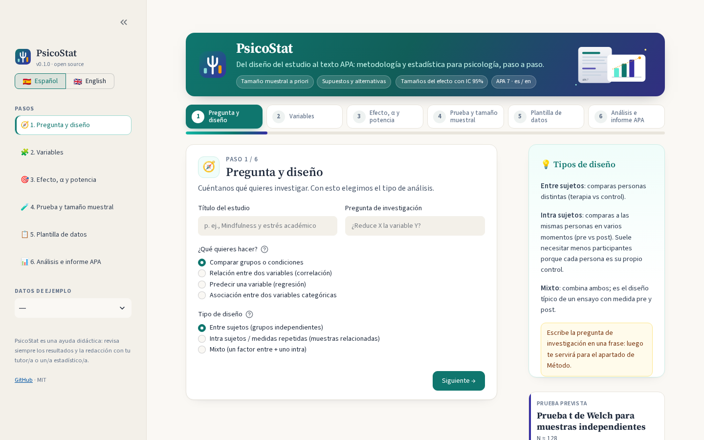
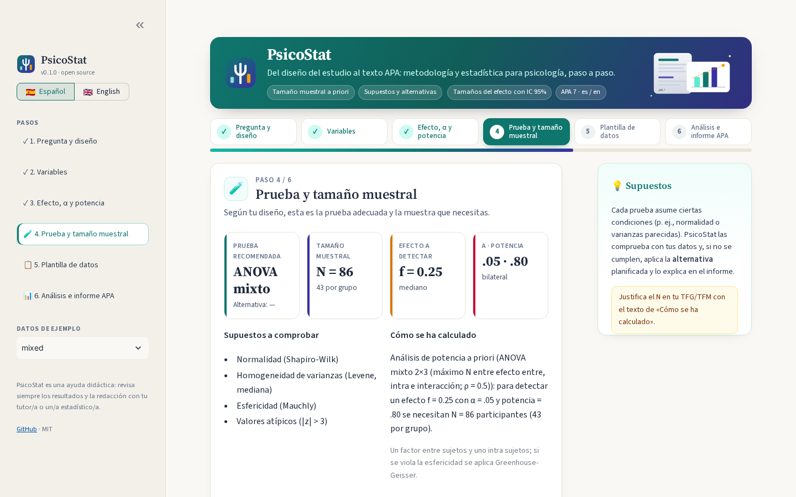
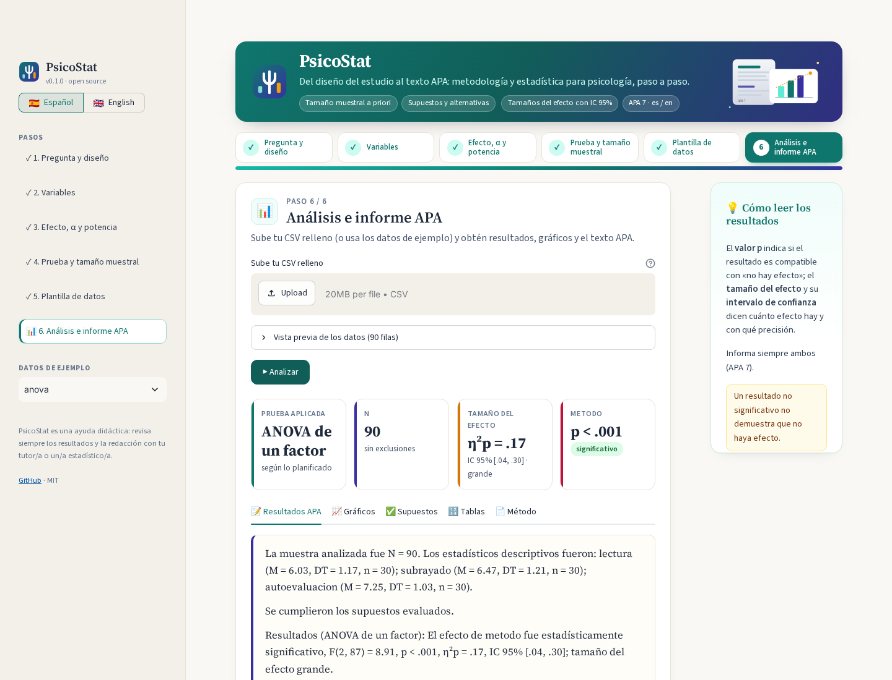

<p align="center"></p>

# PsicoStat 📊

**Demo:** [psicostat.streamlit.app](https://psicostat.streamlit.app/)

**Asistente open source de metodología y análisis estadístico para psicología** · *Open-source methods & statistics assistant for psychology* — [English below](#english)

[](https://github.com/hecogo1/psicostat/actions/workflows/ci.yml)


PsicoStat te guía paso a paso desde la pregunta de investigación hasta el texto de **Método** y **Resultados** en estilo **APA 7**, en español o inglés:

1. **Asistente**: te pregunta el diseño (entre sujetos, intra sujetos, mixto, correlacional, regresión, asociación), número de grupos o condiciones, nivel de medida de las variables, covariables, tamaño del efecto esperado (con la guía de Cohen), α y potencia.
2. **Prueba recomendada**: t de Welch, t pareada, Mann-Whitney, Wilcoxon, ANOVA de un factor / Welch / factorial / medidas repetidas / mixto, ANCOVA, Kruskal-Wallis, Friedman, chi-cuadrado / Fisher, McNemar, Q de Cochran, Pearson / Spearman, regresión lineal y logística; con supuestos a comprobar y alternativa no paramétrica.
3. **Tamaño muestral a priori**, explicado y validado frente a G*Power.
4. **Plantilla CSV** con las columnas exactas de tu diseño + **diccionario de datos**.
5. **Análisis** del CSV relleno: descriptivos, supuestos (Shapiro-Wilk, Levene, Mauchly, Breusch-Pagan, VIF…), la prueba (con cambio automático a la alternativa si fallan los supuestos), **tamaños del efecto con IC 95%**, post hoc (Tukey, Games-Howell, Dunn, Holm) y gráficos.
6. **Informe APA 7** en Markdown y Word (DOCX), en español e inglés.

> ⚠️ PsicoStat es una ayuda didáctica. Revisa siempre los resultados y la redacción con tu tutor/a o un/a estadístico/a.

## Sobre el proyecto

PsicoStat es un proyecto independiente creado por Héctor Cózar, antiguo estudiante de la Facultad de Psicología de la Universidad Complutense de Madrid. No es un proyecto oficial de la universidad.

Nació como un trabajo previo al doctorado, pero su objetivo va más allá: ayudar a la investigación ofreciendo una herramienta accesible a personas con menos formación técnica, para que puedan diseñar la metodología y el análisis estadístico de sus estudios con rigor. Empieza por la psicología, pero está pensada para todas las ciencias sociales y de la salud.



<details><summary>Más capturas / More screenshots</summary>




</details>

## Instalación

```bash
git clone https://github.com/hecogo1/psicostat.git
cd psicostat
python -m venv .venv && source .venv/bin/activate      # Windows: .venv\Scripts\activate
pip install -e ".[app]"
```

## Uso rápido

### Interfaz web (recomendada)

```bash
psicostat app
```

Se abre en el navegador (http://localhost:8501). La barra lateral muestra los seis pasos del asistente (puedes saltar entre ellos), el idioma y los estudios de ejemplo; cada pantalla incluye a la derecha una explicación sencilla del concepto estadístico. Descarga la plantilla en el paso 5 y sube tu CSV en el paso 6. Puedes probar con los **datos de ejemplo** de la barra lateral.

### Línea de comandos

```bash
# 1) Asistente interactivo: crea estudio/diseno.json y estudio/plantilla.csv (+ diccionario)
psicostat wizard --out estudio

# 2) Ver prueba recomendada y tamaño muestral de un diseño
psicostat plan estudio/diseno.json

# 3) Regenerar la plantilla con otro N
psicostat template estudio/diseno.json --n 60 --out estudio/plantilla.csv

# 4) Analizar los datos y generar informes (es + en, Markdown + DOCX)
psicostat analyze estudio/diseno.json estudio/plantilla.csv --out estudio/resultados

# Ejemplos simulados: ttest, mannwhitney, paired, anova, factorial, ancova, rm, mixed,
# chi2, correlation, regression, logistic, mcnemar
psicostat example anova --out ejemplo
psicostat analyze ejemplo/diseno.json ejemplo/datos.csv --out ejemplo/resultados
```

Usa `psicostat --lang en ...` para mensajes en inglés.

**Contrastes unilaterales**: para pruebas t, Mann-Whitney, Wilcoxon y correlaciones puedes plantear una hipótesis direccional (`"alternative": "greater"` = nivel 1 > nivel 2 o relación positiva; `"less"` = lo contrario) en el asistente, en la web (paso 3) o con `--alternative greater|less` en `plan` y `analyze`. El tamaño muestral se calcula con α unilateral y el informe lo indica («p = ,012 (unilateral)», H₁ en el Método). Úsalos solo si la dirección se predijo antes de ver los datos.

**Coma decimal**: añade `--decimal-comma` a `psicostat analyze` (o activa «Coma decimal en el informe» en la barra lateral de la web, o `"decimal_comma": true` en `diseno.json`) para que el informe en español use coma decimal (`M = 3,25; p = ,032; IC 95% [0,08; 1,36]`). El informe en inglés siempre usa punto.

### Desde Python

```python
from psicostat import Design, recommend, sample_size, make_template, analyze, build_report, to_docx

d = Design(analysis="compare", design="between", n_groups=3,
           levels=["lectura", "subrayado", "autoevaluacion"], iv_name="metodo", dv_name="rendimiento")
print(recommend(d).label("es"), sample_size(d)["n_total"])   # ANOVA de un factor 159
res = analyze(d, "datos.csv", outdir="figuras")
to_docx(build_report(res, "es"), "informe.docx")
```

## Ejemplo de salida

> Resultados (ANOVA de un factor): El efecto de metodo fue estadísticamente significativo, F(2, 87) = 8.91, p < .001, η²p = .17, IC 95% [.04, .30]; tamaño del efecto grande. Las comparaciones post hoc (Tukey HSD) mostraron diferencias significativas en: lectura vs autoevaluacion (p < .001); subrayado vs autoevaluacion (p = .025).

Ver [`examples/`](examples/) para informes completos generados con los datos de ejemplo.

## Formato del CSV

- Una fila por participante; columna `id` obligatoria.
- **Entre sujetos**: una columna para el grupo y otra para la VD.
- **Intra sujetos / mixto**: formato ancho, una columna por condición: `<vd>_<condición>` (p. ej., `estres_pre`, `estres_post`).
- Usa punto decimal (`3.5`). Las filas incompletas se excluyen (y se informa).
- Consulta el diccionario de datos que se genera junto a la plantilla.

## Decisiones metodológicas

| Situación | Decisión |
|---|---|
| 2 grupos independientes | t de Welch por defecto (Delacre et al., 2017) |
| Normalidad violada y n < 30 por grupo | Alternativa no paramétrica automática |
| ANOVA con varianzas heterogéneas | ANOVA de Welch + Games-Howell |
| Esfericidad violada (Mauchly p < .05) | Corrección de Greenhouse-Geisser; con dos factores intra sujetos, por efecto (A, B y A × B), informando ε_GG y ε_HF |
| 2×2 con esperadas < 5 | Prueba exacta de Fisher |
| Heterocedasticidad en regresión | Errores típicos HC3 |
| Pruebas de rangos | N a priori ÷ 0.864 (eficiencia relativa asintótica) |
| Regresión logística | 10 eventos por predictor (mín. 100) |

Puedes desactivar el cambio automático con `"auto_fallback": false` en `diseno.json`.

## Contribuir

¡Las contribuciones son bienvenidas! Lee [CONTRIBUTING.md](CONTRIBUTING.md) y el [Código de conducta](CODE_OF_CONDUCT.md).

## Referencias

- American Psychological Association. (2020). *Publication manual of the American Psychological Association* (7th ed.).
- Clopper, C. J., & Pearson, E. S. (1934). The use of confidence or fiducial limits illustrated in the case of the binomial. *Biometrika, 26*(4), 404–413.
- Cohen, J. (1988). *Statistical power analysis for the behavioral sciences* (2nd ed.). Erlbaum.
- Delacre, M., Lakens, D., & Leys, C. (2017). Why psychologists should by default use Welch's t-test. *International Review of Social Psychology, 30*(1), 92–101.
- Faul, F., Erdfelder, E., Lang, A.-G., & Buchner, A. (2007). G*Power 3. *Behavior Research Methods, 39*, 175–191.
- Lakens, D. (2022). Sample size justification. *Collabra: Psychology, 8*(1), 33267.
- Peduzzi, P., et al. (1996). A simulation study of the number of events per variable in logistic regression analysis. *Journal of Clinical Epidemiology, 49*(12), 1373–1379.
- Serlin, R. C., Carr, J., & Marascuilo, L. A. (1982). A measure of association for selected nonparametric procedures. *Psychological Bulletin, 92*(3), 786–790.
- Steiger, J. H. (2004). Beyond the F test: Effect size confidence intervals. *Psychological Methods, 9*(2), 164–182.

---

<a id="english"></a>
## English

**PsicoStat** guides psychology students and researchers step by step from the research question to APA 7 **Method** and **Results** text, in Spanish or English.

**Features**: guided wizard (design, groups/conditions, measurement levels, covariates, expected effect size with Cohen's benchmarks, α, power) → recommended test with assumptions and nonparametric fallback → a priori sample size (validated against G*Power) → CSV template + data dictionary → analysis (descriptives, assumption checks, test, effect sizes with 95% CIs, post hoc tests, plots) → APA 7 report in Markdown and DOCX.

### About

PsicoStat is an independent project by Héctor Cózar, a former student of the Faculty of Psychology at the Complutense University of Madrid. It is not an official university project.

It started as pre-doctoral work, but its goal is broader: to support research by giving less technical researchers an accessible tool to plan the methodology and statistical analysis of their studies rigorously. It starts with psychology but is meant for all the social and health sciences.

### Install

```bash
git clone https://github.com/hecogo1/psicostat.git && cd psicostat
python -m venv .venv && source .venv/bin/activate
pip install -e ".[app]"
```

### Use

```bash
psicostat app                                   # local web UI (choose English in the sidebar)
psicostat --lang en wizard --out study          # interactive CLI wizard
psicostat --lang en plan study/diseno.json      # recommended test + sample size
psicostat --lang en analyze study/diseno.json study/plantilla.csv --out study/results
psicostat example mixed --out demo              # simulated example datasets
```

Reports are always produced in both languages (`informe_es.*`, `informe_en.*`).

### CSV format

One row per participant with an `id` column. Between-subjects: a group column and a DV column. Within/mixed: wide format, one column per condition named `<dv>_<condition>`. Use a dot as decimal separator. Incomplete rows are excluded and reported.

### Contributing

Contributions are welcome — see [CONTRIBUTING.md](CONTRIBUTING.md) and the [Code of Conduct](CODE_OF_CONDUCT.md).

PsicoStat is a teaching aid: always double-check results and wording with your supervisor or a statistician.

License: [MIT](LICENSE).

## Despliegue en Streamlit Community Cloud / Deploy

Repositorio / repository: `hecogo1/psicostat` · rama / branch: `main` · archivo principal / main file path: `streamlit_app.py`. Las dependencias están en `requirements.txt`.
